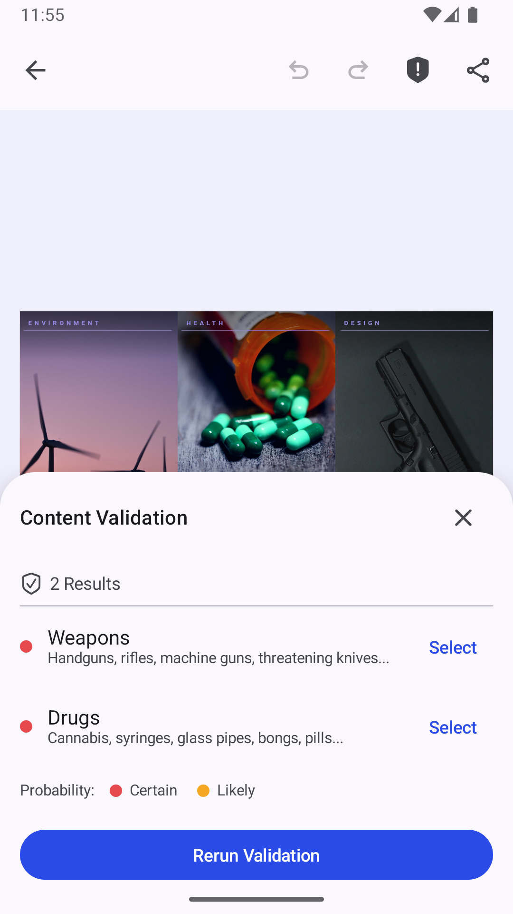

## Content Moderation Starter Kit

  

The starter kit is built on top of the Creative Editor SDK.
It shows how to add automatic content moderation to a design editor: the images **and the text** on the canvas can be checked against a moderation service.

- Images are flagged for Nudity, Weapons, Recreational Drugs, Medical, Alcohol, Offensive Symbols, and Gore.
- Text is flagged for Toxic, Insulting, Discriminatory, Violent, and Sexual language, and for Self-Harm.

A **Content Moderation** button in the navigation bar runs the check on every image and text block in the scene and opens a bottom sheet listing what was flagged, grouped by block: one heading and one **Select** action per block, with its categories listed underneath. Select jumps to that block on the canvas. A text block is headed by a short quote of the flagged text, since its name defaults to "Text". The same check also runs when exporting: if content is flagged, a dialog asks the user to confirm before the export continues.

The moderation backend sits behind a single `ContentModerationProvider` interface. The bundled `GatewayModerationProvider` calls the `imgly/detection` model on the IMG.LY gateway and adds no third-party dependencies (it uses `HttpURLConnection` and `org.json`). To use your own moderation service, implement `ContentModerationProvider` and pass it to `ContentModerationConfigurationBuilder` in `EditorActivity` — nothing else needs to change.

> Note: images already hosted on a public `http(s)` URL are passed to the gateway as a URL. Every other fill — a gallery upload, a bundled asset — is rendered by the engine and uploaded first, so it is checked too. The bundled demo scene ships two captions written to trip the text categories, so the feature is exercisable out of the box.

### Setting Your API Key

The kit moderates images and text with the `imgly/detection` model on the IMG.LY Gateway, which needs an API key with a credit balance.

Acquire one at [img.ly/dashboard](https://img.ly/dashboard): register, generate the API key and contact IMG.LY support to credit the balance for Gateway usage. Model access and credit budgets are configured per key, so the key must have access to `imgly/detection`; top up an existing key at [img.ly/dashboard/credit-balance](https://img.ly/dashboard/credit-balance).

Paste the key into `GATEWAY_API_KEY` in `moderation/GatewayModerationProvider.kt` — every screen in the kit reads it from that one constant.

This key is separate from your CE.SDK license key. Until it is set, running a check reports a "Missing IMG.LY gateway API key" error instead of results.

> Note: a key compiled into an app can be extracted from it. For production, route moderation through a backend you control by implementing `ContentModerationProvider` against it.

### Repository Structure

- Repository is a fully functional Android project with `:starter-kit` and `:app` modules.
- `:starter-kit` library module encapsulates the implementation of the starter kit. Starting point of the starter kit implementation is at `ContentModerationConfigurationBuilder.kt`. The moderation logic lives in the `moderation/` package and the custom navigation bar button, results sheet and export dialog in the `component/` package.
- `:app` application module launches `EditorActivity.kt` that displays the `Editor` composable using `ContentModerationConfigurationBuilder`.

### Building The Repository

1. Clone the repository.
2. [Create and launch](https://developer.android.com/studio/run/managing-avds) a new android emulator or use an existing one.
3. Open the local repository via `Android Studio` and click the `Run` button or go to the local repository via terminal and call `./gradlew installDebug`.

### Useful links

- [CESDK Android Documentation](https://img.ly/docs/cesdk/android)
- [CESDK Android Source Code](https://github.com/imgly/cesdk-android)
- [CESDK Android Examples and Play Store App Code](https://github.com/imgly/cesdk-android-examples)
